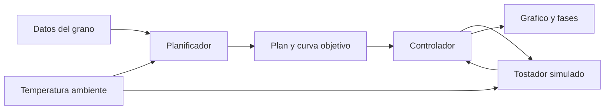

# cafeBot: tueste automático sin saber de café

Nombre visible: **cafeBot**. En el código aparece en un solo constante. El paquete y el identificador interno van en minúscula (`cafebot`), porque las herramientas de Node no aceptan mayúsculas en el nombre del paquete.

Cambiar el nombre más adelante:

- El texto de la ventana, el título y el README salen de esa constante. Cambiarla renombra la app en la interfaz.
- El repositorio, cuando exista, se renombra en el sitio donde esté alojado. El historial de commits se conserva y la dirección vieja suele redirigir a la nueva.
- La carpeta donde se guardan los tuestes usa el identificador interno, no el nombre visible. Así un cambio de nombre no esconde los tuestes ya guardados.
- El identificador de la app empaquetada (`appId`) se puede cambiar sin costo mientras nadie tenga cafeBot instalado. Después, cambiarlo hace que Windows y Mac la traten como otra aplicación.

## Para quién es

cafeBot compite con Artisan. El mercado es quien ya tuesta con Artisan y hoy maneja la curva a mano. cafeBot le pide el grano y el sabor de la taza, arma el plan y lo ejecuta.

La meta de máquinas es la misma lista que Artisan ya reconoce. Esa lista no es un enchufe único: Artisan tiene un controlador por modelo, y cafeBot también. Cada modelo se agrega con su adaptador. La primera máquina real va a ser la que se compre, una de esa lista. Este corte no incluye ninguno: un tostador simulado entrega temperatura de grano, temperatura del aire del tambor y temperatura ambiente, y responde a gas y flujo de aire. La interfaz de máquina queda separada para ir sumando adaptadores. Importar curvas o registros de Artisan queda para un corte siguiente.

Roastline (roastline.ai) ya ocupa el lugar de copiloto: lee la curva en vivo, dice qué hacer, predice la taza y puede repetir un perfil ya armado en algunas máquinas (Aillio, Kaleido, Ikawa, Skywalker). En el puente Phidget/Artisan el control automático no está: solo lectura y guía. Se presenta como una capa encima del criterio de quien ya tuesta, con plan de pago. cafeBot sigue en el otro lugar: la persona no trae un perfil; describe el grano y la app arma el tueste y lo ejecuta, en local y sin suscripción.

## Qué puede hacer alguien

1. Cuenta el grano en lenguaje llano: origen, proceso (lavado, natural, honey o “no sé”), altura aproximada o “no sé”, y qué quiere en la taza (chocolate, nuez, fruta, floral o balanceado) más un tueste claro, medio u oscuro. También indica la temperatura de la sala. En este corte ese número es la lectura del simulador: viene en 22 °C y se puede cambiar antes de tostar para probar un cuarto frío o caliente.
2. La app propone un plan: duración, temperatura de carga, fases (secado, Maillard, desarrollo), curva objetivo y una frase del resultado esperado. La persona acepta o pide otro plan.
3. Al empezar, el tueste corre solo. Un gráfico muestra temperatura de grano, temperatura del aire y velocidad de subida, y la pantalla muestra la temperatura ambiente. Gas y aire se mueven solos. Se puede acelerar la simulación, frenar o cortar.
4. Al terminar, queda un resumen entendible y el tueste se guarda en el equipo para volver a verlo.

## Sin backend

No hace falta un servidor ni una base de datos. El planificador, el controlador, el tostador simulado y el historial corren dentro de la app. Nada sale de la máquina.

El historial es de toda la app, no de una pantalla, y vive en el equipo de esa persona:

- En Electron, un archivo `tuestes.json` en la carpeta de datos de la app (`userData`). Ahí quedan los granos, los planes y las curvas.
- Al abrir la interfaz en el navegador para probar, el mismo contenido va en `localStorage` de esa ventana, bajo la clave `cafebot.tuestes`.

No se usa SQLite, ni un paquete de storage, ni un almacén compartido entre computadoras.

Un backend solo haría falta para cuentas, sincronizar varios equipos o esconder una clave de un servicio externo. Eso queda fuera.

## Cómo se reparte la “inteligencia”

El plan lo arma un planificador local, con reglas de tueste. Proceso, altura, perfil de taza y temperatura ambiente cambian la temperatura de carga, el ritmo de secado y el tiempo de desarrollo. Una sala más fría sube la carga y el gas del arranque, porque el tambor pierde calor hacia el cuarto. No llama a un modelo en internet.

El ajuste en vivo lo hace un controlador en la misma app: compara la curva real con la del plan y sube o baja gas y aire. Si la temperatura se dispara, corta el calor. Reacciona al segundo, sin red.

## Librerías

Solo estas. El planificador, el controlador y el simulador son código propio, sin librerías de tueste ni de inteligencia artificial.

- `electron` abre la ventana de escritorio. `electron-vite` la arma en desarrollo y `electron-builder` genera los instaladores de Windows y Mac.
- `react` y `react-dom` dibujan la interfaz. `typescript` es el lenguaje.
- `tailwindcss` define el estilo. Los botones, campos y diálogos salen de shadcn/ui, que no es un paquete que se hospede: se copia el código y trae `@radix-ui/react-*` (el comportamiento de cada control), `class-variance-authority`, `clsx`, `tailwind-merge` y `lucide-react` (íconos).
- `recharts` dibuja la curva de temperatura de grano, la del aire y la velocidad de subida.
- `vitest` corre las pruebas del planificador, el simulador y el controlador.

No hay librería de base de datos, de red ni de modelo. Los tuestes se guardan en `tuestes.json` dentro de Electron y en `localStorage` cuando la interfaz se abre en el navegador.

## Cómo se prueba

La carpeta del proyecto se crea al implementar, con `electron-vite` como base. No hace falta que armes un template a mano.

Para usarla en el día a día no se compila un instalador. En la carpeta del proyecto, `npm install` una vez y `npm run dev` abre la ventana de cafeBot. Cada cambio de código se ve al guardar. La misma interfaz también se puede abrir en el navegador, sin Electron.

El instalador (`.exe` en Windows, `.dmg` en Mac) se genera aparte, cuando querés una app instalada. El de Mac se arma en una Mac y el de Windows en Windows. El README va a traer esos comandos.

## App

- Electron con React, TypeScript y Tailwind.
- La misma interfaz corre en el navegador (servidor de Vite en un puerto poco común) y dentro de Electron, para poder verla y empaquetarla para Windows y Mac.
- Textos de la interfaz en español.
- Tres pantallas: nuevo tueste, tueste en vivo, historial.
- Estados vacíos (sin tuestes guardados), de carga del plan y de error (plan inválido o tueste interrumpido).
- Escritorio y ventana angosta.

## Lógica testeable, fuera de la interfaz

En TypeScript puro, con pruebas:

- El planificador devuelve un plan válido para varios granos distintos, y un ambiente más frío sube la carga y el gas inicial.
- El simulador reacciona: más gas sube la temperatura; más aire la frena; un ambiente más frío aumenta la pérdida de calor.
- El controlador baja el gas cuando el grano va adelantado respecto del plan, y corta si la temperatura se va de rango.
- El tueste simulado llega a la descarga dentro de una ventana razonable.

## Qué queda fuera de este corte

- Máquina real, sondas y protocolos (Modbus, TC4, etc.).
- Curvas de referencia importadas de Artisan.
- Cuentas, nube y varios usuarios.
- Una app mobile con React Native. El tueste corre en la computadora que está junto a la máquina. El planificador, el simulador y el controlador quedan en TypeScript para poder reutilizarlos si más adelante hay una pantalla de teléfono.

## Compatibilidad de la tostadora

cafeBot tuesta solo si la máquina cumple las cuatro condiciones a la vez. Que Artisan la reconozca alcanza para la temperatura, y no alcanza para el control.

1. **Curva.** Envía temperatura de grano y temperatura del aire del tambor al menos una vez por segundo, en un número que el programa pueda leer.
2. **Mandos.** Durante el tueste acepta un porcentaje de calor y un porcentaje de aire desde la computadora, y el siguiente segundo se nota en la curva. En Artisan eso se ve si los deslizadores mueven el quemador y el ventilador. Si Artisan solo dibuja la curva y el gas se gira a mano, cafeBot no puede tostar solo.
3. **Un solo programa.** El puerto (USB, serie, red o Bluetooth) lo usa una app por vez. Artisan tiene que estar cerrado mientras cafeBot tuesta.
4. **Corte si se cae el cable.** Al perder la conexión, el quemador baja solo o hay una llave física de gas. El botón de la app no alcanza si el cable ya no está.

Queda en la persona, y la app le dice el momento: cargar el verde, descargar al enfriador y, si no hay sonda de sala, anotar la temperatura ambiente. Si el tambor tiene velocidad, se fija una vez al empezar y no hace falta ir moviéndola.

No sirve una máquina que tuesta con su propia pantalla y no acepta calor y aire desde afuera. Tampoco una placa que solo lee termocuplas.

El protocolo se escribe para un modelo. El filtro de compra es: Artisan ya controla esa máquina, no solo la registra. En la Aillio Bullet eso no cierra la compra: hay que probar el USB actual antes.

## Aillio Bullet, antes de comprar

Candidata: Bullet R2. Artisan documenta el control (ventilador, calor, velocidad del tambor, temperatura de grano y del aire) por un protocolo USB propio de Aillio. Aillio advierte que RoasTime actual, de la v3 en adelante, no convive con los drivers de Artisan. Para usar Artisan en Windows hacen falta drivers viejos, sin soporte oficial. Aillio recomienda RoasTime para las funciones de seguridad y diagnóstico.

Eso no niega que Artisan pueda manejar la R2. Deja la compra en pausa hasta comprobar el puerto en el firmware actual.

cafeBot no usa Artisan ni sus drivers. Habla el USB de la Bullet directo, con el driver que RoasTime instala hoy (en Windows, WinUSB). La prueba, con una máquina real, es:

- Leer temperatura de grano y de aire al menos una vez por segundo.
- Fijar calor, aire y una velocidad de tambor, y ver el cambio en la curva.
- Soltar el cable o cerrar la app y comprobar que el calor baja solo, o que queda una llave física.
- Hacerlo sin instalar el driver viejo de Artisan y sin tener RoasTime abierto. Un solo programa usa el puerto.

Aillio no publica el protocolo. La referencia pública es el controlador de Artisan, y el firmware lo fue cambiando. Hasta pasar esa prueba, la R2 no entra al plan de construcción. Este corte sigue en el simulador.

## Cuando haya tostadora real

Correr la app no exige una tostadora. El simulador alcanza para todo este corte.

El día que se tueste café de verdad, hace falta un modelo concreto, no cualquiera. El planificador y el controlador se quedan. El simulador se reemplaza por un adaptador de esa máquina.

Una tostadora automatizada suele traer adentro las dos sondas y los mandos de calor y aire. cafeBot puede usarla si esos datos salen por un puerto (USB, serie o red) y el puerto acepta órdenes. Una máquina que tuesta sola en su propia pantalla y no abre ese puerto no se puede manejar desde afuera.

El puerto es el cable, no un idioma común. Dos tostadoras con USB pueden hablar protocolos distintos, y dentro de un mismo protocolo (por ejemplo Modbus) cada marca usa registros distintos. cafeBot corre en los modelos para los que exista un adaptador. La máquina va a ser una que Artisan ya soporte, que es el filtro de compra. El adaptador de ese modelo se escribe cuando esté elegido, y ese trabajo no entra en este corte.

Hace falta:

- Tres temperaturas. La del grano (sonda en la masa de café) y la del aire del tambor se leen al menos una vez por segundo. En la mayoría de las tostadoras de taller esas dos sondas ya están puestas. En una máquina casera hay que agregar termocuplas tipo K y una placa que las lea (TC4, Phidget o equivalente). La temperatura ambiente es la tercera: una sonda en la sala, fuera del tambor, si la máquina o la placa la tienen. Si no hay sonda de sala, se escribe el número una vez por tueste, leído con un termómetro común.
- Dos mandos que la computadora pueda mover: calor (gas o potencia) y aire (ventilador o compuerta). Si la máquina solo deja leer temperaturas, cafeBot puede mostrar la curva y no puede ejecutar el plan sola.
- Un cable hasta la computadora, casi siempre USB o serie, y el protocolo de ese modelo. Cada marca habla distinto. El adaptador se escribe para una máquina concreta.
- Un corte de calor en la propia máquina, además del botón de la app. Si se corta el cable, el quemador tiene que poder apagarse sin el programa.
- Unos tuestes reales de esa máquina para calibrar: el mismo porcentaje de gas no calienta igual en dos tostadoras. Con esas curvas se ajusta cuánto gas y aire usa el controlador.
